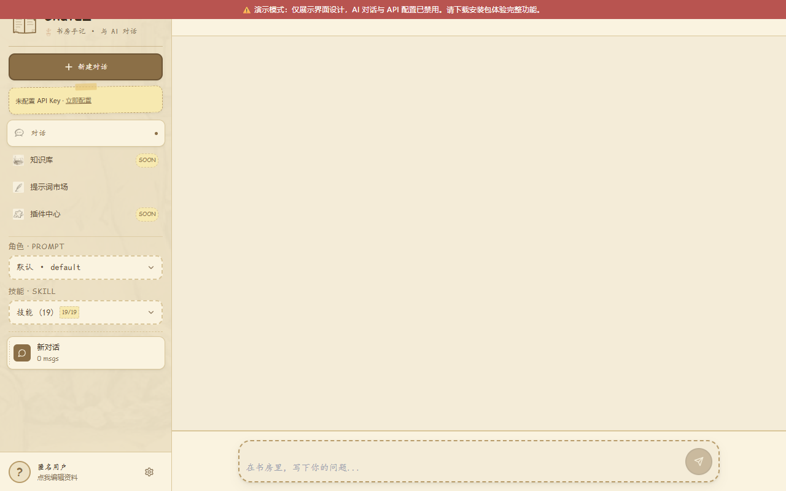

# Chatez

[](LICENSE)
[](CHANGELOG.md)
[](https://github.com/anyuer678/chatez/actions/workflows/ci.yml)

**可配置 Prompt + Skill 的 AI 工作台** — v1.14.2

纯 Web 应用。提供多 Prompt 角色切换、Skill 技能系统、流式输出、会话持久化等功能。

<p align="center"></p>


> ⚠️ **在线预览为演示模式**：仅展示界面设计（主题切换、Prompt 市场、Skill 列表均可浏览）。出于安全考虑，**演示版禁用了 API Key 配置与 AI 对话**——密钥绝不会进入静态页面。本地完整功能请自行构建运行（`npm i && npm run dev`）。

## 功能特性

### 核心功能
- **多 Prompt 角色切换** — 内置面试官、翻译、故事等 Prompt，支持自定义创建/编辑
- **Skill 技能系统** — 命令触发（`/sql`、`/explain`）+ 自动识别，支持自定义 Skill
- **流式输出** — SSE 流式响应，实时显示 AI 生成内容
- **会话管理** — 多会话切换、自动标题生成、会话持久化（localStorage）

### 配置与设置
- **GenerationPanel** — 温度、Top-P、频率/存在惩罚、最大 Token 等参数独立调节
- **API 配置** — 支持 OpenAI / 自定义兼容接口，密钥管理与导出脱敏
- **主题切换** — 浅色 / 深色模式
- **快捷键** — `Ctrl+,` 打开设置、`Enter` / `Ctrl+Enter` 切换发送方式

## 界面
- 响应式布局，适配桌面和移动端
- Markdown 渲染 + 代码高亮
- 消息复制、重新生成

## 快速开始

### 环境要求
- Node.js >= 20
- npm

### 开发运行

```bash
npm install
npm run dev       # Web 开发模式
npm run build     # 生产构建
```

### 构建产物
- **Web**: `dist/`

## 技术栈

| 层级 | 技术 |
|------|------|
| 前端 | React 18 + TypeScript + Tailwind CSS |
| 测试 | Vitest |
| 构建 | Vite 5 |

## 项目结构

```
chatez/
├── src/                          # 源码
│   ├── components/               # UI 组件
│   │   ├── Chat/                 # 对话相关（ChatWindow, InputBox, MessageBubble）
│   │   ├── Layout/               # 布局（AppLayout, Sidebar）
│   │   └── ...                   # 其他组件
│   ├── stores/                   # 状态管理
│   ├── assets/                   # 静态资源
│   └── ...                       # 类型定义
├── public/                       # 静态资源
├── docs/                         # 文档
└── package.json                  # 项目配置
```

## 生态

本项目属于 [作品体系](https://anyuer678.github.io/yuer.dev/map) 中的 **AI Agent 生态** 主线——定位为浏览器端 AI 会话客户端（多 Provider 接入、流式渲染）。

同一体系内相关项目：

- [lumen](https://github.com/anyuer678/lumen) —— Go Agent Runtime（内置 MCP 注册 / 沙箱工具执行）
- [keyvault](https://github.com/anyuer678/keyvault) —— 本机 LLM 密钥保险库（chatez 为纯 Web 应用，无法直接读取本机 CLI，目前仅文档级关联）
- [kb-ui](https://github.com/anyuer678/kb-ui) —— Vue 3 组件库（本仓库为 React 技术栈，未直接依赖，仅同体系展示）

## License

[GPL-3.0](LICENSE)